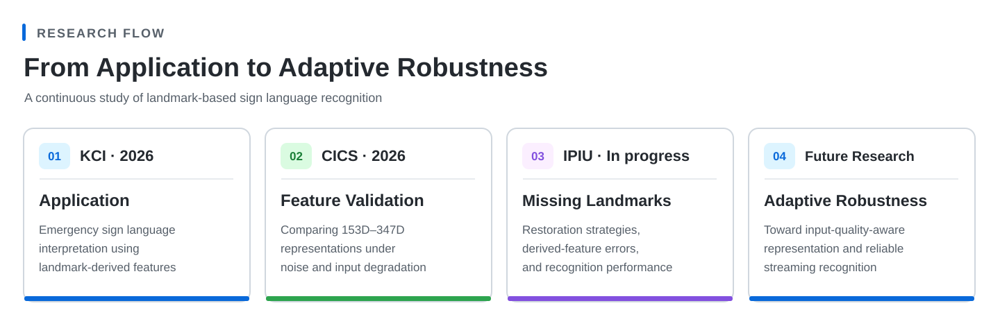

<h1 align="center">Sign Language Landmark Research</h1>

  <strong>From emergency sign language interpretation to reliable landmark representations.</strong> 
  A continuing research journey in landmark-based sign language recognition (SLR).

  <a href="docs/research-flow.md"><b>Research Story</b></a> &nbsp;·&nbsp;
  <a href="docs/cics-2026.md"><b>CICS 2026</b></a> &nbsp;·&nbsp;
  <a href="docs/research-stages.md"><b>Methods & Stages</b></a> &nbsp;·&nbsp;
  <a href="docs/publications.md"><b>Publications</b></a>

  
  
  
  

---

## Overview

This repository documents how one practical sign language recognition project evolved into a broader investigation of **landmark-derived features, input reliability, and downstream recognition**.

> **How do we build an accurate sign language recognizer—and how can we trust its representations when landmark observations become unreliable?**

## Research Journey

  

| Stage | Core research question | Status |
|:--|:--|:--|
| **01 · KCI** — Emergency SLR application | Can landmark-based recognition support communication in emergency situations? | **Published** · Jan 2026 |
| **02 · CICS** — Feature validation | Do richer landmark-derived representations consistently improve accuracy and robustness? | **CICS'26 official program** · SS07-07 |
| **03 · IPIU-oriented** — Missing-landmark analysis | How do recovery methods affect coordinate, derived-feature, and recognition errors? | **Research ongoing** · Manuscript in preparation |
| **04 · Future research** — Adaptive robustness | Can feature use adapt to the reliability of incoming landmark observations? | **Exploratory direction** |

### From application to adaptation

The starting point was a working emergency interpretation system. Follow-up research investigated whether adding engineered features really improves recognition under clean and degraded landmark observations. This raised a deeper question: **does a better coordinate reconstruction necessarily preserve the motion and geometric features that a classifier needs?**

The next direction is to explore reliability-aware adaptation instead of treating every input frame and landmark as equally dependable.

## Research Focus

| Topic | Scope |
|:--|:--|
| **Landmark representation** | 153D, 306D, 317D, and 347D project-specific feature sets |
| **Robustness** | Landmark noise, hand occlusion, missing observations, and temporal frame skipping |
| **Evaluation** | Coordinate errors, derived-feature distortions, and sign recognition metrics |
| **Long-term question** | Input-adaptive processing under practical streaming constraints |

## Publications & Conference Research

**Hong Jeongmin et al. (2026).** *긴급상황 속 수어해석 애플리케이션* (Emergency sign language interpretation application). **Journal of the Institute of Electronics and Information Engineers**, 63(1), 81–88.

**Hong Jeongmin & Lee Yae Sop (2026).** *Landmark 기반 수어 인식에서 특징 조합에 따른 성능 및 입력 변형 민감도 비교*. **CICS'26**, Special Session 7, SS07-07. [Official program](https://cics.kiee.or.kr/pages/special_session.vm) · [Study overview](docs/cics-2026.md).

Explore the **[research story](docs/research-story.md)**, **[methods overview](docs/research-stages.md)**, and **[publication status](docs/publications.md)** for the full narrative and confirmed milestones.

> [!NOTE]
> This is a **public-facing research portfolio**, not a source-code or dataset release. Raw datasets, private evaluation artifacts, model weights, and unpublished implementation details are excluded. Numbers from different datasets or evaluation protocols should not be compared directly.

<strong>한국어 요약</strong>

긴급상황 수어 해석 애플리케이션 구현(KCI)에서 출발해, 랜드마크 파생 특징의 유효성과 교란 강건성(CICS)을 검증하고, 결측 랜드마크 복원에 따른 좌표·파생 특징·인식 성능의 관계(IPIU 준비)를 분석하는 연구의 발전 과정을 기록합니다. 향후 연구에서는 입력 신뢰도에 적응하는 강건한 수어 인식을 탐색합니다.

